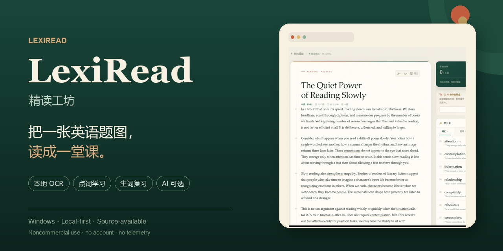
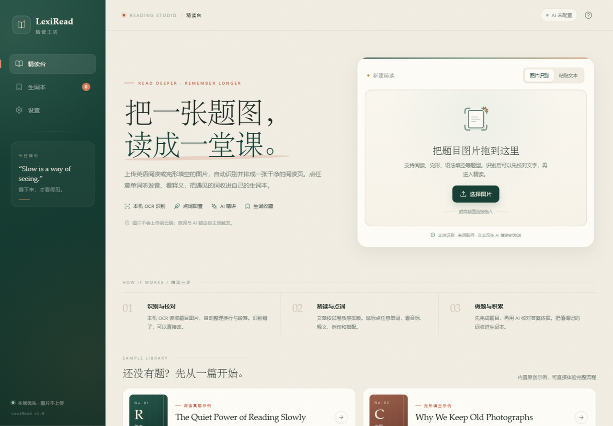
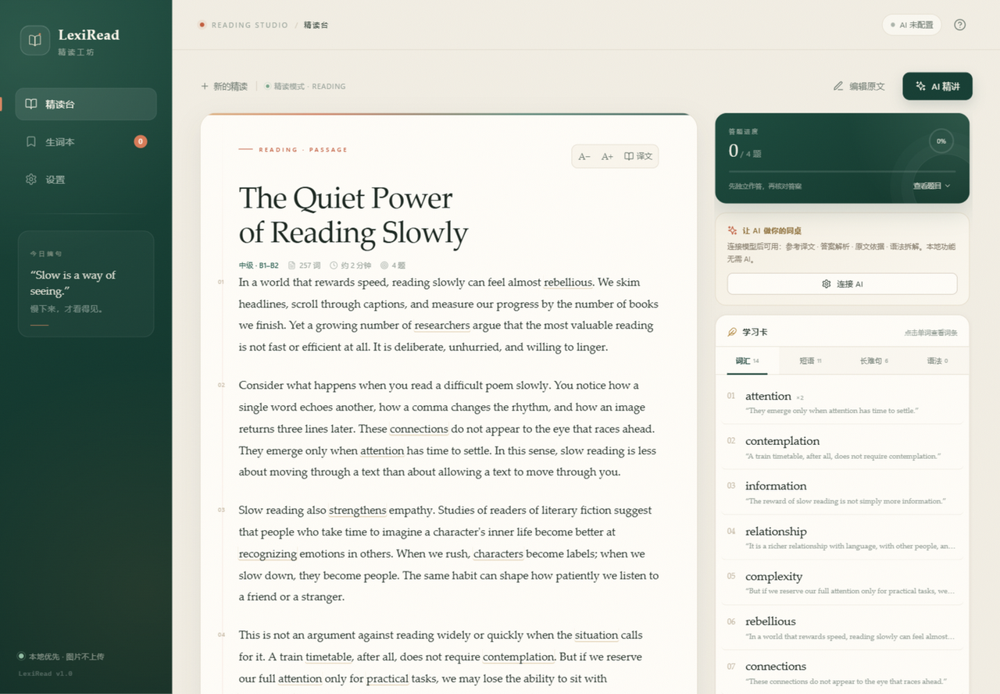
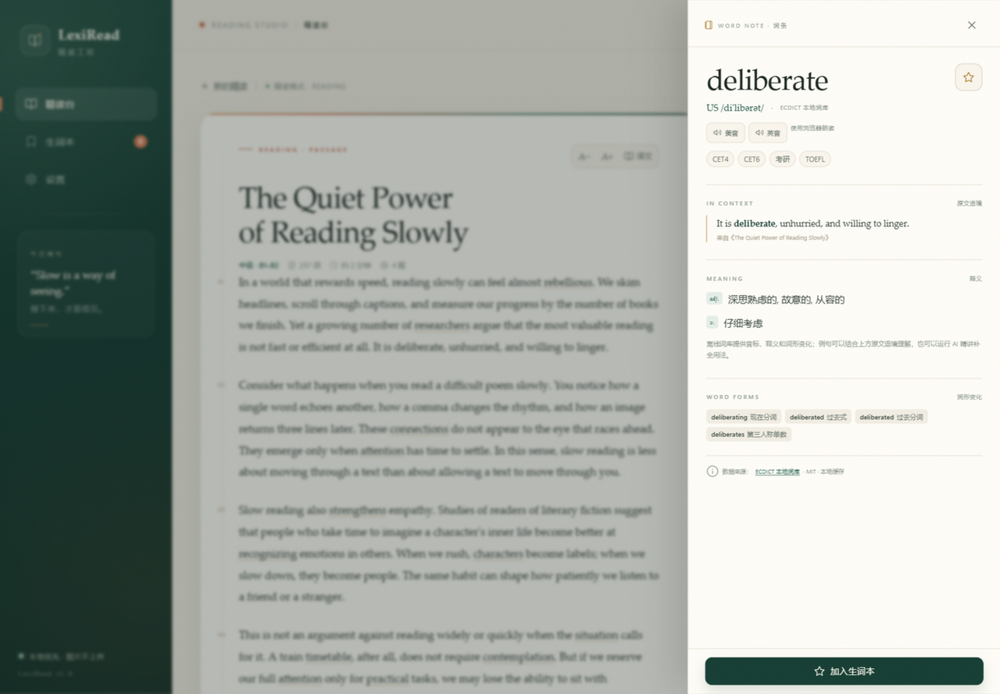

# LexiRead · 精读工坊

**把一张英语题图，读成一堂课。**

Local-first English reading studio for Windows: OCR a reading/cloze photo, turn it into a clean reading page, click any word for phonetics/definitions/word forms, collect a wordbook that stays on your computer, and optionally ask your own AI model for evidence-based explanations.

源码公开，采用 **PolyForm Noncommercial 1.0.0**：个人学习、研究、学校/公益机构等非商业用途免费使用；未经单独书面授权，不得用于商业用途。它不属于 OSI 定义的开源许可证，详情见 [LICENSE](LICENSE) 和 [COMMERCIAL.md](COMMERCIAL.md)。

[English README](README_EN.md) · [中文使用说明](#快速开始) · [参与贡献](CONTRIBUTING.md) · [隐私说明](PRIVACY.md) · [作者](AUTHORS.md)




> 项目状态：可用的早期版本。题库、AI 解析和数据结构都可能继续调整，欢迎反馈。



## 为什么做这个

大多数英语工具把“查词”“翻译”“做题”“背单词”拆散在四个地方。LexiRead 想保留一整条学习路径：

1. 把题图识别成可校对的文字；
2. 排成一张能舒服读完的阅读页；
3. 点开每个不熟悉的词，看它的音标、释义、词形和原文语境；
4. 先做题，再用 AI 对照原文依据；
5. 把值得记的词收进生词本，之后复习。

图片默认只在本机处理，不需要注册账号，也没有埋点统计。

## 功能

- **本机 OCR**：调用 Windows 自带 OCR，图片不上传；识别后先校对再进入精读。
- **阅读 / 完形排版**：自动拆文章、题干、选项和空格，保留阅读页的排版感。
- **点词学习**：26,000 词条的 ECDICT 离线词库，提供中文释义、音标、考试标签、词形变化；本地未收录时再查 Wiktionary。
- **原文语境**：词条会显示它在这篇文章里的句子，而不是只给一个孤立释义。
- **AI 精讲（可选）**：兼容 OpenAI Chat Completions，生成中文译文、答案与原文依据、长难句拆解、语法点。没有 API Key 也能用本地功能。
- **生词本**：SQLite 本地存储，支持搜索、学习中/已掌握、抽认卡复习和 CSV 导出。
- **隐私优先**：没有账号、没有遥测；AI 只在用户主动点击时调用，Key 由用户自己提供。





## 快速开始

### 方式一：下载 Windows 便携版

在 [Releases](../../releases) 下载最新 Windows 便携包，解压后运行 `LexiRead.exe`。  
程序会在 exe 同目录创建 `data/` 文件夹，请放在可写的目录中。

> 未签名的公开源码构建 exe 可能触发 Windows SmartScreen 提示。请只从本仓库 Releases 下载，并核对 SHA256。

### 方式二：从源码运行

需要 Windows 10/11、Python 3.10+。

```bat
git clone https://github.com/sonic111222/lexiread.git
cd lexiread
python -m pip install -r requirements.txt
python app.py
```

作者 GitHub：[@sonic111222](https://github.com/sonic111222)

或双击 `start.bat`。浏览器会自动打开 `http://127.0.0.1:5057`；如果端口被占用，程序会自动选择下一个端口，以启动窗口打印的地址为准。

### 第一次使用

1. 拖入一张阅读或完形填空图片，或者先点首页的原创示例。
2. 在 OCR 校对弹窗里改掉识别错字，点“进入精读”。
3. 点击任意单词查看词条；点“加入生词本”收藏。
4. 想用 AI 时，到「设置 → AI 精讲连接」填写自己的兼容接口。

### OCR 说明

- 使用 Windows OCR，必须有 OCR 语言组件。
- 当前只有中文语言包时也能识别英文，但个别字符可能出错；在 Windows「设置 → 时间和语言 → 语言」中安装 English 语言包会更稳定。
- 识别结果永远可以先编辑，再精读。
- 单栏、清晰的截图效果最好；复杂双栏讲义建议先裁剪。

## AI 配置（可选）

支持 DeepSeek、OpenAI、通义千问、智谱 GLM、本地 Ollama，以及任意 OpenAI Chat Completions 兼容服务。

- Base URL 示例：`https://api.deepseek.com/v1`
- 模型示例：`deepseek-chat`
- API Key：只保存在本机 `data/lexiread.db`
- 本地 Ollama 可以不填 Key

**仓库不包含任何 AI Key。** Key 不会发送到浏览器；AI 请求由本机 Python 进程直接发给你配置的模型服务。

AI 返回的是参考解析，不是考试标准答案。项目不会承诺提分或押题。

## 词典为什么是可插拔的

核心查词 API 不直接依赖某个网站：

```text
Browser
   ↓
/api/word/<word>
   ↓
DictionaryService  (cache / fallback / normalize)
   ↓
┌──────────────┬─────────────────┐
│ ECDICT       │ Wiktionary       │
│ offline, MIT │ online, CC BY-SA │
└──────────────┴─────────────────┘
```

默认顺序是 `ecdict → wiktionary`。只有本地词库没有收录时才联网，也可以在 `LEXIREAD_DICTIONARY_PROVIDERS` 中调整顺序。新增一个来源只需实现 `backend/providers/base.py` 中的 `DictionaryProvider` 接口。

这样做是为了：

- 默认公开源码版本不内置未授权的抓取接口；
- 某个词典服务挂了不会让整个功能崩掉；
- 贡献者可以接入有商用授权的词典（需要同时补充来源和许可证）；
- 应用层和 UI 不需要知道词从哪里来。

词典数据来源与许可见 [THIRD_PARTY_NOTICES.md](THIRD_PARTY_NOTICES.md)。

## 隐私

- 图片：本机 OCR，不上传。
- 离线词典：不上网。
- 在线词典：本地未收录时，单个单词会发给 `api.dictionaryapi.dev`。
- AI：只有主动点击“AI 精讲”时，题目文本才会发送给你配置的模型。
- 账号、遥测、广告 SDK：无。
- 本地数据：`data/lexiread.db`、`data/uploads/`、浏览器 localStorage。

完整说明见 [PRIVACY.md](PRIVACY.md)。

## 开发

```bat
python -m pip install -r requirements.txt
python app.py
```

运行测试：

```bat
python -m unittest discover -s tests -v
```

构建 Windows 便携版：

```bat
build_windows.bat
```

输出 `dist\LexiRead.exe`，会在同目录创建 `data/`。发布流程、SmartScreen 和
GitHub Actions 说明见 [docs/BUILD.md](docs/BUILD.md)。

目录结构：

```text
app.py                  Flask entry point
backend/
  analyzer.py           text → passage/questions/vocabulary/phrases
  ocr.py                Windows OCR bridge + OCR cleanup
  dictionary.py         cache/fallback service
  providers/            interchangeable dictionary sources
  ai.py                 OpenAI-compatible structured analysis
  storage.py             SQLite persistence
  samples.py             original demo material
  data/                  ECDICT subset + licenses
static/
  index.html
  css/app.css
  js/app.js, api.js
tools/
  windows_ocr.ps1
  build_ecdict_subset.py
tests/
```

贡献指南：[CONTRIBUTING.md](CONTRIBUTING.md)  
安全问题：[SECURITY.md](SECURITY.md)  
发布与推广清单：[docs/LAUNCH.md](docs/LAUNCH.md)

## 已知限制

- 只支持 Windows（依赖 Windows OCR）。
- 复杂多栏排版、手写体、低分辨率图片的 OCR 效果有限。
- 离线词典是常用词子集，不是完整词典；例句主要来自文章语境和在线补充。
- AI 解析取决于用户配置的模型，可能有错误；请自行核对原文。
- 公开源码客户端不包含账号、云同步或托管 AI 服务。

## License

代码、界面文字、文档、项目截图和原创示例以 [PolyForm Noncommercial 1.0.0](LICENSE) 授权。

- **允许**：个人学习、研究、实验、爱好项目，以及教育机构、公益组织、公共研究/医疗机构等非商业使用。
- **需要单独授权**：售卖软件、付费托管服务、商业产品集成、广告变现或其他商业用途。
- 这不是 OSI 认证的开源许可证，准确称呼是 **source-available / 源码公开**。
- 本许可证不包含 LexiRead 名称和 Logo 的商标授权；fork 请使用自己的品牌名。

版权声明与 Required Notice 见 [NOTICE](NOTICE)，商业使用说明见 [COMMERCIAL.md](COMMERCIAL.md)。  
Bundled ECDICT data is MIT licensed; Wiktionary content and dependencies have
their own terms. See [THIRD_PARTY_NOTICES.md](THIRD_PARTY_NOTICES.md) and the
[LICENSES](LICENSES/) directory.

如果你觉得这个项目有用，欢迎 Star、提 Issue 或分享给正在练英语阅读的人。

---

© 2026 [sonic111222](https://github.com/sonic111222) · Source-available under [PolyForm Noncommercial 1.0.0](LICENSE)。
