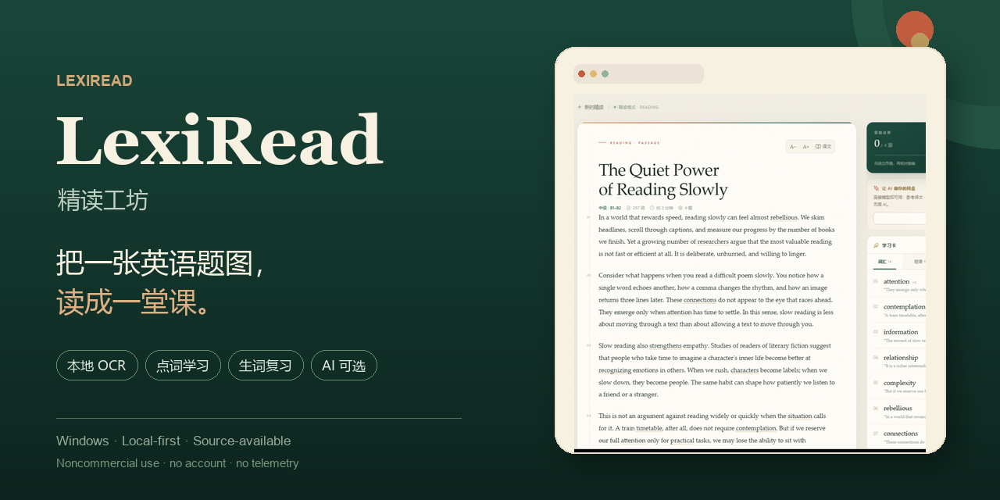
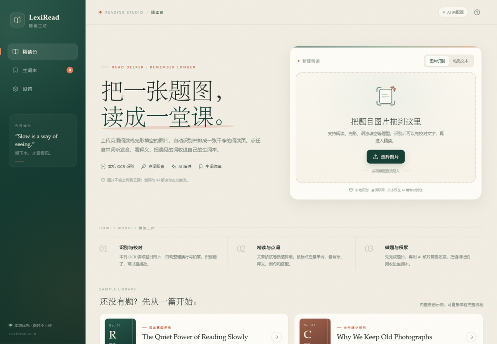
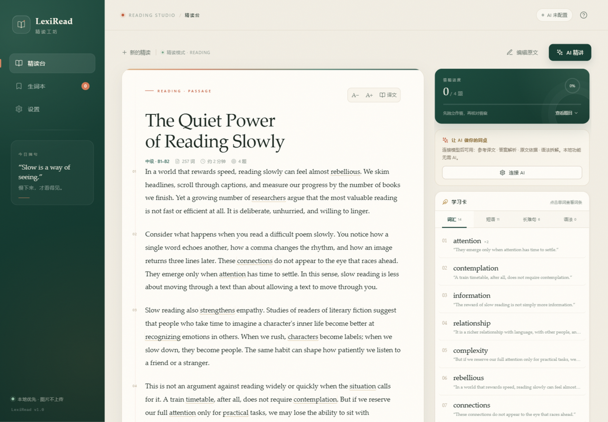
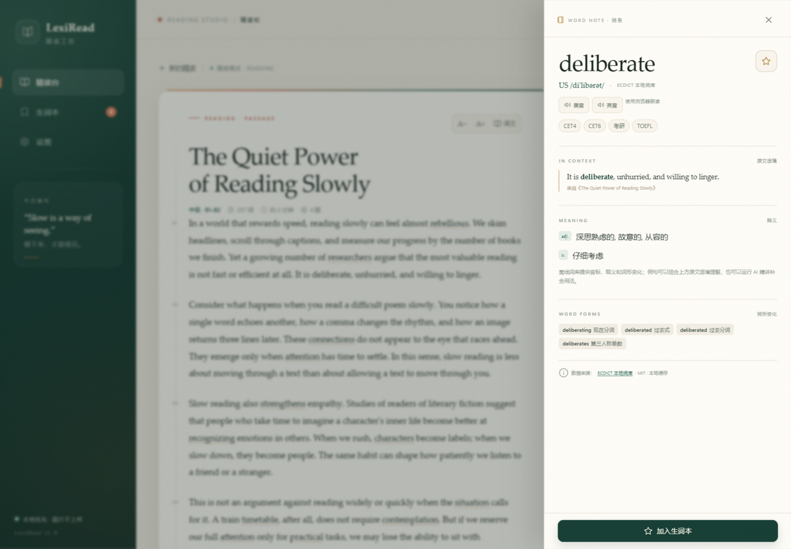

# LexiRead

**Turn an English exam screenshot into a reading lesson.**

LexiRead is a local-first English reading studio for Windows. It uses the OCR
engine built into Windows to read a passage or cloze-test photo, turns it into a
clean reading page, and makes every word clickable. A bundled offline ECDICT
subset provides Chinese definitions, phonetics, exam tags and word forms; an
optional AI model can add translations, answer evidence, sentence analysis and
grammar notes.

**Source-available, not OSI open source.** The project uses the PolyForm
Noncommercial License 1.0.0: personal study, research, schools and other
noncommercial use are free; commercial use requires a separate written license.
See [LICENSE](LICENSE) and [COMMERCIAL.md](COMMERCIAL.md).

[中文 README](README.md)





## Features

- Local OCR through Windows; images never leave the machine.
- Reading and cloze-test layouts with editable OCR review.
- 26,000-entry offline ECDICT subset (Chinese definitions, phonetics, forms).
- Wiktionary online fallback only when the offline dictionary has no entry.
- Click any word for definitions, pronunciation, source context and word forms.
- Local SQLite wordbook with search, mastered/learning status, CSV export and
  flashcard review.
- Optional OpenAI-compatible AI analysis, with the user's own API key.
- No account, no telemetry, no bundled API keys.





## Quick start

Requirements: Windows 10/11 and Python 3.10+.

```bat
git clone https://github.com/sonic111222/lexiread.git
cd lexiread
python -m pip install -r requirements.txt
python app.py
```

GitHub: [@sonic111222](https://github.com/sonic111222)

Or run `start.bat`. The app opens on `http://127.0.0.1:5057` and picks the next
free port if that one is busy.

A prebuilt Windows portable release is attached to [Releases](../../releases)
when available. The executable is currently unsigned, so Windows SmartScreen may
show a warning.

## OCR notes

Install an English OCR language pack in Windows for the best results. The app
also works with a Chinese OCR language pack, but individual characters may be
misread. OCR output can always be edited before analysis.

## AI setup

Open Settings → AI connection. Any OpenAI Chat Completions compatible endpoint
works: DeepSeek, OpenAI, Qwen, Zhipu or a local Ollama server. The API key is
stored only in the local SQLite database and is never returned to the frontend.
No key is bundled with this repository.

AI output is study assistance, not an authoritative exam answer.

## Dictionary providers

The lookup service is deliberately source-agnostic:

```text
/api/word/<word>
      ↓
DictionaryService
      ↓
ECDICT (offline, MIT) → Wiktionary (online, CC BY-SA)
```

To add a provider, implement `DictionaryProvider` in
`backend/providers/base.py`, register it in `backend/providers/__init__.py`, and
include its source/license attribution. Do not submit scraped or unlicensed
dictionary data.

See [THIRD_PARTY_NOTICES.md](THIRD_PARTY_NOTICES.md).

## Privacy

- Images stay local.
- Offline lookups stay local.
- An online lookup sends only the selected word to `api.dictionaryapi.dev`.
- AI sends the passage only after the user explicitly clicks "AI 精讲".
- No telemetry, accounts or ad SDKs.

Details: [PRIVACY.md](PRIVACY.md)

## Development

```bat
python -m unittest discover -s tests -v
```

Build the portable Windows executable:

```bat
build_windows.bat
```

The output is `dist\LexiRead.exe`; the app creates a `data/` folder next to it.
See [docs/BUILD.md](docs/BUILD.md) for release and SmartScreen notes.

See [CONTRIBUTING.md](CONTRIBUTING.md) and [SECURITY.md](SECURITY.md).

## License

The code, interface text, documentation, original project screenshots and
original sample passages are licensed under the **PolyForm Noncommercial
License 1.0.0**.

- Personal study, research, experimentation, hobby projects and use by
  educational institutions, charities and public institutions are permitted
  noncommercial uses.
- Selling the software, paid hosting, commercial product integration, ad
  monetization or other commercial use requires a separate written license.
- This is **not** an OSI-approved open-source license; it is source-available.
- The license does not grant trademark rights to the LexiRead name or logo.
  Forks should use their own brand.

See [NOTICE](NOTICE), [AUTHORS.md](AUTHORS.md) and
[COMMERCIAL.md](COMMERCIAL.md). Third-party data and dependencies remain under
their own licenses; see [THIRD_PARTY_NOTICES.md](THIRD_PARTY_NOTICES.md).

---

© 2026 [sonic111222](https://github.com/sonic111222). Source-available under [PolyForm Noncommercial 1.0.0](LICENSE).
